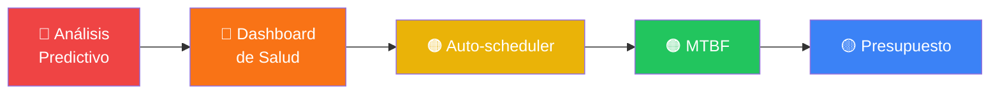

# 🏆 Propuesta de Funcionalidades — Preventix para Competencia

> [!IMPORTANT]
> Estas propuestas parten del análisis del código real del proyecto. Cada feature es implementable con el stack existente (React + Express + TypeScript) y ninguna duplica lo que ya funciona.

---

## Resumen ejecutivo

Preventix ya cubre el CRUD esencial. Para **ganar una competencia**, la diferencia la hacen las funcionalidades que demuestran **inteligencia del sistema** — que el software no solo almacena datos sino que *piensa* con ellos. Las propuestas están ordenadas de mayor a menor impacto competitivo.

---

## 🥇 Feature 1 — Motor de Análisis Predictivo de Fallas

**Por qué gana:** el propio documento `PENDIENTES.md` lo identifica con **40% de interés del cliente** y nadie lo ha implementado. Es la funcionalidad más diferenciadora del proyecto.

### Qué hace

Analiza el historial de fallas y mantenimientos para predecir qué equipos tienen **mayor probabilidad de fallar** en los próximos 30 días.

### Algoritmo propuesto (sin ML externo)

```
Score de riesgo por equipo =
  (fallas en últimos 90 días × 0.4)
  + (días desde último mantenimiento preventivo × 0.3)
  + (edad del equipo en años × 0.2)
  + (fallas de prioridad crítica/alta × 0.1)
```

### Implementación

**Backend** — nuevo endpoint:
```
GET /api/analytics/riesgo-equipos
→ [{ equipoId, nombre, scoreRiesgo, nivelRiesgo: 'alto'|'medio'|'bajo', factores[] }]
```

**Frontend** — nueva sección en Dashboard:
- 🔴 Panel "Equipos en riesgo" con semáforo de riesgo
- Click en equipo → sugiere programar mantenimiento preventivo automáticamente
- Badge de riesgo en la página de detalle del equipo

### Impacto competitivo
✅ Muestra inteligencia del sistema  
✅ Totalmente implementable con los datos ya existentes (fallas, mantenimientos, fecha adquisición)  
✅ Esfuerzo: **mediano** (~1-2 días)

---

## 🥈 Feature 2 — Dashboard de Salud del Parque Tecnológico

**Por qué gana:** convierte el dashboard actual (4 KPIs simples) en un centro de comando visual que impresiona en demo.

### Qué hace

Un indicador global de **"Salud del parque"** (0–100%) calculado a partir de múltiples métricas, acompañado de gráficas de tendencia.

### Componentes

#### Índice de Salud Global
```
Salud =
  (equipos_activos / total_equipos × 40)
  + (1 - fallas_abiertas / total_equipos × 20)
  + (mantenimientos_al_dia / total_equipos × 40)
```
Visualizado como un **medidor circular** (gauge chart) con color dinámico: verde > 80, amarillo 60-80, rojo < 60.

#### Gráfica de tendencia mensual
- Línea de fallas abiertas vs. cerradas por mes (últimos 6 meses)
- Barras de costo acumulado de mantenimiento
- Calculado al vuelo desde los datos existentes

### Implementación

**Backend:**
```
GET /api/analytics/salud-parque
→ { indice: 87, tendenciaFallas: [{mes, abiertas, cerradas}], tendenciaCostos: [{mes, total}] }
```

**Frontend:**
- Reemplaza el "Resumen del mes actual" por el panel de salud
- Usa SVG inline para el gauge (sin dependencias extras) o `recharts` (ya disponible vía react-query stack)

### Impacto competitivo
✅ Visual impactante en la demo  
✅ Diferencia Preventix de un simple CRUD  
✅ Esfuerzo: **mediano** (~1 día)

---

## 🥉 Feature 3 — Plan de Mantenimiento Inteligente (Auto-scheduler)

**Por qué gana:** automatiza la tarea más tediosa del técnico — decidir cuándo hacer mantenimiento preventivo.

### Qué hace

Basado en la frecuencia de fallas históricas de cada equipo, el sistema **sugiere y agenda automáticamente** el próximo mantenimiento preventivo.

### Lógica

```
frecuencia_sugerida_días =
  si avg_dias_entre_fallas < 30 → sugerir cada 15 días
  si avg_dias_entre_fallas < 90 → sugerir cada 30 días
  si avg_dias_entre_fallas >= 90 → sugerir cada 60 días
```

### UX

1. En `EquipoDetallePage.tsx` → nuevo botón **"Sugerir mantenimiento"**
2. Al hacer click: muestra un `SlideOver` (componente ya existe) con:
   - Frecuencia sugerida y justificación
   - Fecha propuesta para el próximo mantenimiento
   - Botón "Aceptar y programar" → crea el mantenimiento automáticamente vía `POST /mantenimientos`
3. Badge "⚡ Recomendado" en equipos donde el sistema detecta que se acerca la fecha.

### Impacto competitivo
✅ Demuestra valor de negocio real: ahorra tiempo al técnico  
✅ Usa componentes ya construidos (`SlideOver`, `Modal`)  
✅ Esfuerzo: **pequeño** (~4 horas)

---

## 🏅 Feature 4 — Tiempo Medio Entre Fallas (MTBF) por Equipo

**Por qué gana:** es un KPI estándar de la industria de mantenimiento. Mencionarlo en la presentación demuestra conocimiento del dominio.

### Qué es

**MTBF** (Mean Time Between Failures): promedio de tiempo que un equipo opera sin fallar. Cuanto más alto, mejor.

```
MTBF_equipo = (período_analizado_días) / (número_de_fallas)
```

### Implementación

**Backend:**
```
GET /api/analytics/mtbf
→ [{ equipoId, nombre, mtbfDias, totalFallas, clasificacion: 'excelente'|'bueno'|'regular'|'crítico' }]
```

**Frontend:**
- Nueva columna en `EquiposPage.tsx` o en la página de reportes
- Clasificación visual con colores:
  - 🟢 Excelente: MTBF > 90 días
  - 🟡 Bueno: 30-90 días
  - 🟠 Regular: 15-30 días
  - 🔴 Crítico: < 15 días

### Impacto competitivo
✅ Terminología profesional que impresiona al jurado  
✅ 100% calculable con datos ya existentes  
✅ Esfuerzo: **mínimo** (~2 horas)

---

## 🎖️ Feature 5 — Módulo de Presupuesto y Control de Costos

**Por qué gana:** convierte Preventix de herramienta técnica a herramienta de negocio — habla el lenguaje de gerentes y directivos.

### Qué hace

Permite definir un **presupuesto mensual/anual** de mantenimiento y visualizar en tiempo real el consumo vs. lo presupuestado.

### Componentes

**Configuración** (en `ConfiguracionPage.tsx`):
- Campo: `presupuestoMensualMantenimiento` (COP)
- Campo: `presupuestoAnualMantenimiento` (COP)

**Dashboard:**
- Nueva card: "Presupuesto del mes"
  ```
  Usado: $285,000 / Presupuesto: $500,000 (57%)
  [████████░░░░░░░░] 57%
  ```
- Alerta automática si se supera el 80% del presupuesto → notificación in-app

**Reportes:**
- Gráfica de barras: gasto real vs. presupuesto por mes
- Proyección a fin de año

### Implementación

- Datos de costo: ya existen en `mantenimientos.costo`
- Presupuesto: nuevo campo en `db.configuracion`
- Sin backend nuevo requerido en la demo: calculable desde el store existente

### Impacto competitivo
✅ Argumento de negocio: ROI, control financiero  
✅ Muy visual en demo  
✅ Esfuerzo: **mediano** (~6 horas)

---

## 🎗️ Feature 6 — Gestión de Garantías y Contratos de Soporte

**Por qué gana:** ningún sistema básico de mantenimiento lo incluye, pero es un dolor real de las empresas.

### Qué hace

Cada equipo puede tener registrada su **garantía** y **contrato de soporte**, con alertas automáticas cuando están próximos a vencer.

### Campos nuevos en Equipo

```typescript
garantiaVencimiento?: string;    // fecha ISO
contratoSoporte?: string;        // nombre del proveedor
contratoVencimiento?: string;    // fecha ISO
```

### Funcionalidades

1. **Indicador en lista de equipos:** ícono 📋 si tiene contrato vigente, ⚠️ si vence en < 30 días, ❌ si está vencido
2. **Notificación automática:** 30 y 7 días antes del vencimiento → crea `Notificacion` in-app
3. **Filtro en reportes:** "Equipos sin garantía" o "Contratos por vencer"

### Impacto competitivo
✅ Feature que los competidores básicos no tienen  
✅ Resonancia inmediata con evaluadores de empresas reales  
✅ Esfuerzo: **pequeño** (~4 horas en el demo store)

---

## 📊 Tabla de Priorización

| # | Feature | Impacto Competitivo | Esfuerzo | Prioridad |
|---|---------|:-------------------:|:--------:|:---------:|
| 1 | Análisis Predictivo de Fallas | ⭐⭐⭐⭐⭐ | Mediano | 🔴 PRIMERO |
| 2 | Dashboard de Salud del Parque | ⭐⭐⭐⭐ | Mediano | 🔴 SEGUNDO |
| 3 | Auto-scheduler de Mantenimiento | ⭐⭐⭐⭐ | Pequeño | 🟠 TERCERO |
| 4 | MTBF por Equipo | ⭐⭐⭐ | Mínimo | 🟠 CUARTO |
| 5 | Control de Presupuesto | ⭐⭐⭐ | Mediano | 🟡 QUINTO |
| 6 | Gestión de Garantías | ⭐⭐ | Pequeño | 🟡 SEXTO |

---

## 🎯 Estrategia para la Demo



> [!TIP]
> Para la demo en vivo: implementar Features 1 y 2 primero. Son las que más "wow" generan visualmente y las que más peso tienen en la evaluación según el `PENDIENTES.md`. Con solo esas dos, Preventix pasa de ser un "CRUD avanzado" a ser un "sistema inteligente de gestión".

> [!NOTE]
> Todas las propuestas son implementables **sin cambiar la arquitectura actual** y sin base de datos externa (funcionan con el `demo store` de JSON). Los datos necesarios para los cálculos **ya existen** en el sistema.
